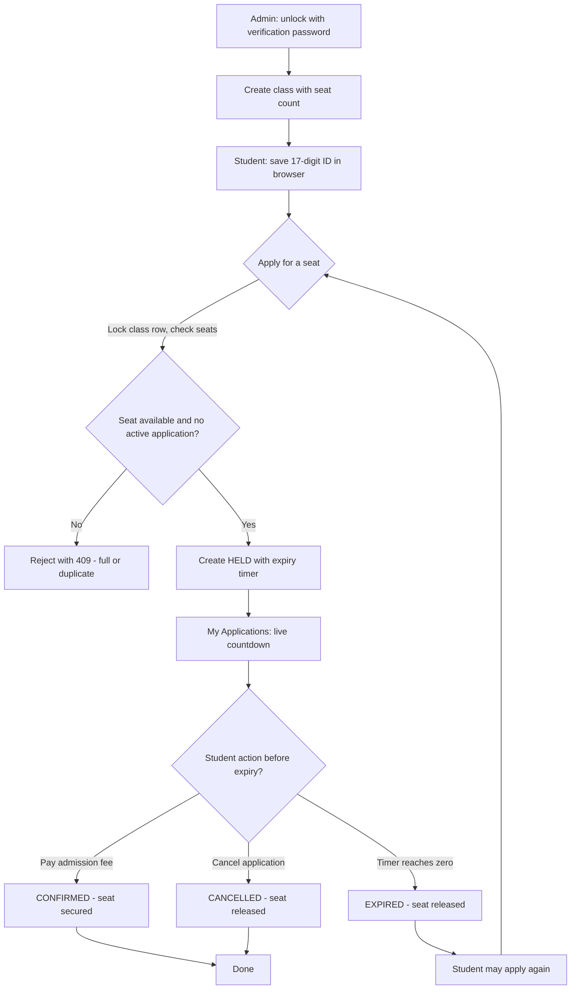

# Assumptions

The brief intentionally leaves some details open. These are the decisions made and why.

## Domain

- Each shift is a separate class with its own seat count; there is no separate `Shift` entity.
- The student’s 17‑digit birth registration number is used as the identity, sent in `X-Student-Id`. It is validated as exactly 17 ASCII digits.
- Class editing and deletion are not required, so `totalSeats` never changes after creation.
- An optional admin verification password can be sent in the `X-Admin-Password` header on `POST /classes`. This is an extra security layer not required by the API contract; requests without the header are accepted and proceed without admin protection. If the header is provided, it is verified against the hash stored in the `AdminCredentials` table.

The API contract is followed exactly regardless of whether the admin password header is present. The header is an optional extra added for this implementation.

## Hold lifecycle

- The hold duration comes from `HOLD_DURATION_SECONDS` (default 600 seconds). A value of `0` means the hold expires immediately.
- Seat availability is derived, not stored: `availableSeats = totalSeats − heldSeats − confirmedSeats`, never below zero. A seat becomes free the instant its deadline passes, even before any cleanup runs.
- A background service runs every 5 seconds to persist `HELD → EXPIRED` transitions; correctness does not depend on it.
- Status rules: confirming an already `CONFIRMED` hold is idempotent; confirming an expired hold returns `409`; cancelling a `CONFIRMED` hold returns `409`; cancelling an already `CANCELLED`/`EXPIRED` hold is idempotent.
- One student may not have two active (HELD or CONFIRMED) applications in the same class. A second hold while an active one exists returns `409`. After expiry or cancellation the student may apply again.
- Clicking “Pay admission fee” is assumed to succeed; no payment gateway is involved.

## HTTP semantics

- `POST /classes` returns `201` with `{id, name, totalSeats}`. The optional `X-Admin-Password` header, if provided, is verified against the hash stored in the `AdminCredentials` table; if omitted, the request proceeds without admin protection. Other `POST`/`DELETE` endpoints return `201`/`204` as appropriate. `GET` endpoints return `200`.
- Invalid input (bad JSON, missing headers, non‑positive seats) returns `400`; a wrong admin password (header provided but incorrect) returns `401`; unknown identifiers return `404`; ownership violations return `403`; capacity conflicts return `409`. No invalid input should produce `500`.
- Ids are opaque strings with prefixes (`c_…`, `h_…`) but any format was allowed.

## Concurrency

- Seat allocation runs inside a transaction that first locks the class row with `SELECT ... FOR UPDATE`. While the lock is held all requests for that class are serialised, so two backend processes on different ports still obey the capacity rule.
- A partial unique index on `(ClassId, StudentId)` filtered to `HELD`/`CONFIRMED` is an additional database‑level guard for the one‑active‑application rule. Stale `HELD` rows are expired before inserting a new hold so the index does not block a legitimate re‑application.

## Rate limiting

- The API uses ASP.NET Core's built-in `AddRateLimiter` with a per‑student window (keyed by `X-Student-Id` header when present, otherwise by IP address).
- Default limit: 30 requests per 30 seconds per student or IP. This prevents a single user or script from flooding `POST /classes/{id}/holds` or the polling endpoints while still allowing normal usage.
- When the limit is exceeded, the API returns `429 Too Many Requests` with the body `"Too many requests, please wait a moment"` and a `Retry-After: 30` header. The frontend displays this message to the user.
- These limits are not a spec requirement, but they address the brief's concern about thousands of parents applying at the same time, and the configuration can be adjusted via the `RateLimiter:PermitLimit` and `RateLimiter:Window` settings in `appsettings.json`.

## Frontend

- The UI polls class and application data every 4 seconds and runs a 1‑second countdown per held application. The countdown removes action buttons the instant it reaches zero, without a page reload.
- The student id is stored in `localStorage`, so refresh or reopening the browser keeps the student’s applications visible.
- The Admin tab is visible to everyone, but creating classes requires the verification password, which is checked on the server. The tab shows the demo password only because this project is a demo; a real deployment would keep it secret.
- The UI rate‑limiting message "Too many requests, please wait a moment" is displayed when the server returns `429`. The frontend reads the response body and shows it to the user.

## Admission flow (plain‑text)

```
Verify admin password → Create class → Student saves 17‑digit ID → Apply for a seat → Seat HELD with expiry timer → Live countdown → Pay fee (CONFIRMED) or Cancel (CANCELLED) or Timer expires (EXPIRED) → Student may apply again.
```

## Admission flow (mermaid)

